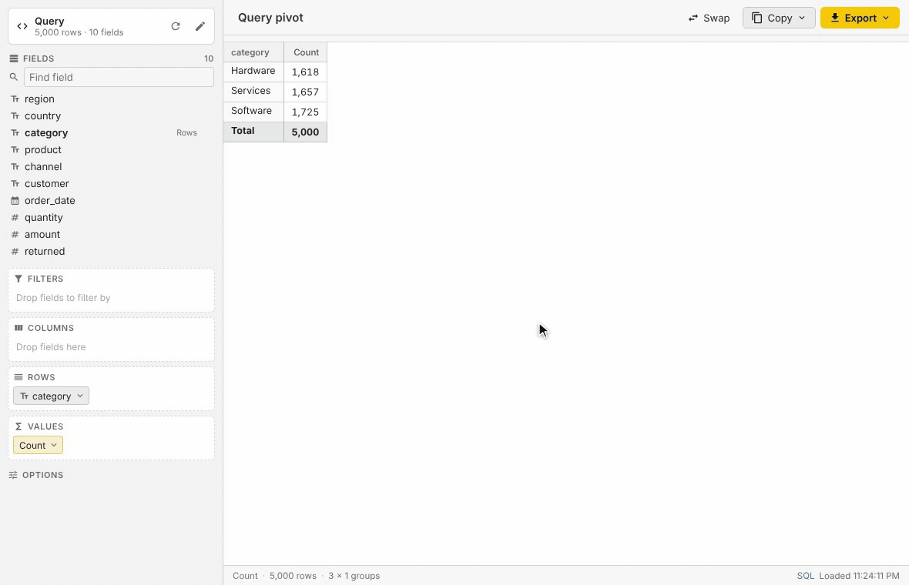
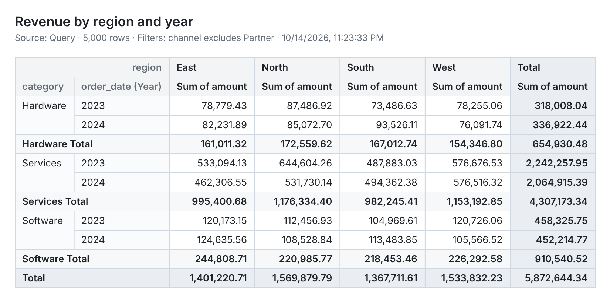
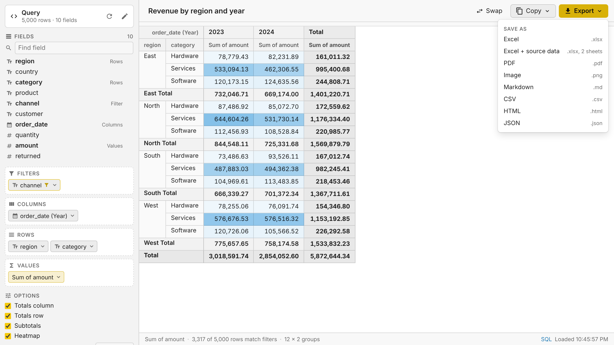
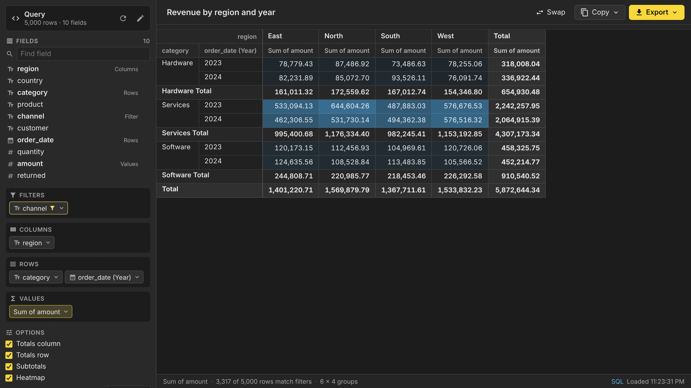

# Pivot Tables for Beekeeper Studio

Turn any query result, grid selection or table in [Beekeeper Studio](https://www.beekeeperstudio.io)
into a pivot table, then share it as an Excel workbook, PDF, image, Markdown, CSV, HTML or JSON.



<sub>Recorded in the plugin's dev harness with 5,000 sample orders. Sped up slightly.</sub>

## Features at a glance

|                         |                                                                                                    |
| ----------------------- | -------------------------------------------------------------------------------------------------- |
| **Drag-and-drop**       | Rows, Columns, Values and Filters, like a spreadsheet pivot table                                  |
| **11 aggregations**     | Count, count distinct, sum, average, min, max, median, std deviation, variance, first, last        |
| **% of total**          | Show any value as a share of the grand, row or column total                                        |
| **Date grouping**       | Year, quarter, month, week, day, hour, month of year, day of week                                  |
| **Filters and sorting** | Pick values with search and counts; sort A→Z, Z→A or by value                                      |
| **Layout**              | Totals, subtotals, values in columns or rows, fixed decimals, heatmap                              |
| **8 export formats**    | Excel, Excel + source data, PDF, PNG, Markdown, CSV, HTML, JSON                                    |
| **3 ways to copy**      | Spreadsheet cells, Markdown table, image                                                           |
| **Any data source**     | Grid selections, queries, tables (with the tab's filters), up to 100,000 rows                      |
| **Fits in**             | Follows the light or dark theme, saves each tab's layout, runs locally with no network calls       |

## Building a pivot

Every column of the data appears in the **Fields** list. Drag a field into a zone, or click it and
choose where it goes:

- **Rows** and **Columns** group the data. Stack several fields to nest groups, and drag chips
  to reorder them. **Swap** flips rows and columns.
- **Values** are the numbers in the cells. The same field can be added more than once, for
  example to show its sum and its average side by side. With no values, the pivot counts rows.
- **Filters** narrow the data without adding a row or column.

Drag a chip back to the field list to remove it. Click any chip for its options.

### Summarizing values

Click a value chip to change what it shows:

| Summarize by                                              | Works on                                    |
| --------------------------------------------------------- | ------------------------------------------- |
| Count, count distinct                                     | Any column, or rows when no field is picked |
| Sum, average, median, standard deviation, variance        | Numbers, including numeric text             |
| Minimum, maximum                                          | Numbers, dates and text                     |
| First, last                                               | Any column                                  |

**Show as** turns a value into a percentage of the grand total, its row total or its column total.

### Grouping, filtering and sorting

Click a row, column or filter chip for:

- **Group dates by** year, quarter, month, ISO week, day, hour, month of year or day of week.
  Dates are grouped as written in the database, so time zones don't shift them.
- **Show values:** a checklist of every value with its row count, a search box, All / None, and
  "only" to keep a single value. Filtered chips are highlighted.
- **Sort** labels A→Z or Z→A (numbers sort numerically, nulls go last), or by the size of
  the first value, largest or smallest first.

### Layout options

Under **Options** in the sidebar:

- **Totals column** and **totals row** for grand totals, and **subtotals** for each group
  when rows or columns are nested.
- **Values in** columns or rows, for pivots with several values.
- **Decimals:** auto (whole numbers stay whole, other values use 2 places, percentages 1) or a
  fixed 0 to 4 places.
- **Heatmap** shades each value from its smallest to its largest.

The title at the top names the tab and appears on exports.

## Exporting and sharing

**Export** saves a file. Exports always contain the whole pivot, even when the on-screen grid only
shows the first rows of a very large one.

| Format                  | What you get                                                                                                     |
| ----------------------- | ---------------------------------------------------------------------------------------------------------------- |
| **Excel**               | Merged headers, number and percentage formats, bold totals and frozen header rows and label columns              |
| **Excel + source data** | The same workbook with a second sheet of the loaded rows, ready to re-pivot in Excel                              |
| **PDF**                 | Landscape when wide. Shrinks to fit where it can and splits very wide pivots into pages that repeat the row labels |
| **Image**               | A sharp PNG with the title, source and filters, ready for slides, docs or chat                                    |
| **Markdown**            | A GitHub-style table for READMEs, issues and wikis                                                               |
| **CSV**                 | One header row and raw numbers, with row labels repeated on every row                                            |
| **HTML**                | A standalone styled page that keeps merged headers                                                               |
| **JSON**                | One object per row, keyed by column header                                                                       |

**Copy** puts the pivot on the clipboard as spreadsheet cells (pastes into Excel or Google
Sheets, percentages included), as a Markdown table, or as an image.

This is the PNG the **Image** export produces for the pivot in the demo:



## Opening a pivot table

| Where                                                                  | Menu item                  | Data used                                             |
| ---------------------------------------------------------------------- | -------------------------- | ----------------------------------------------------- |
| New tab dropdown (next to `+`), **Tools** menu                         | Pivot Table                | A query or table picked in the plugin                 |
| Query results or table data: right-click a cell or the top-left corner | Pivot Table from Selection | The selected cells                                    |
| Query tab header or the query editor's right-click menu                | Pivot Query Results        | The query, run again with a row limit                 |
| Table in the sidebar, or a table tab header                            | Open in Pivot Table        | The table, with the tab's filters as a `WHERE` clause |

To pivot a whole result set from the grid, select every cell first (click the top-left corner of
the grid or press Ctrl/Cmd+A), then right-click.

The data source can be changed at any time with the pencil button in the sidebar, which accepts a
SQL query or a table with an optional `WHERE` clause. **SQL** in the status bar shows the exact
query that loaded the data.

## Row limits

Pivots are calculated in the plugin, so the data is loaded with a row limit: 10,000 rows by
default, configurable up to 100,000 (the choice is remembered).

- Queries are wrapped as `SELECT * FROM (<query>) AS pivot_source LIMIT n` (`TOP` on SQL
  Server, `ROWNUM` on Oracle, `FIRST` on Firebird), so the database does the limiting.
- If the database rejects the wrapped query (for example a CTE on SQL Server), a prompt offers to
  run the query as written and keep the first rows. Statements that may change data are never
  re-run without confirmation.
- Databases without SQL subqueries (MongoDB, Redis, Cassandra and similar) run the query as
  written and keep the first rows.
- A banner shows when the limit was reached. Totals only cover the rows that were loaded.
- When a saved tab is reopened, query sources wait for a click on **Run query** instead of
  running automatically. Selections and tables load straight away.

## Light and dark themes

The plugin uses Beekeeper Studio's theme colors and switches along with the app.

| Light                                                      | Dark                                                           |
| ---------------------------------------------------------- | -------------------------------------------------------------- |
|       |       |

## Installing

Once published, install **Pivot Tables** from **Tools → Manage Plugins** in Beekeeper Studio
(5.5 or newer).

To install a build manually, download `bk-plugin-pivot-tables-<version>.zip` from the
[releases](https://github.com/rathboma/bk-plugin-pivot-tables/releases) and extract it into
Beekeeper Studio's plugins directory:

- Linux: `~/.config/beekeeper-studio/plugins/bk-plugin-pivot-tables`
- macOS: `~/Library/Application Support/beekeeper-studio/plugins/bk-plugin-pivot-tables`
- Windows: `%APPDATA%\beekeeper-studio\plugins\bk-plugin-pivot-tables`

## Development

```bash
yarn install
yarn dev        # links the project into Beekeeper's plugins directory and serves it with hot reload
yarn harness    # runs the plugin in a browser against a fake Beekeeper Studio
yarn test:run   # unit tests (Vitest)
yarn typecheck
yarn build      # production build into dist/
yarn package    # release zip in release/ (after yarn build)
```

`yarn dev` uses [`@beekeeperstudio/vite-plugin`](https://www.npmjs.com/package/@beekeeperstudio/vite-plugin),
which symlinks the project into the plugins directory. Enable plugins in Beekeeper Studio, then
open a pivot from any of the menus above.

`yarn harness` serves `dev/host.html` at <http://localhost:5199/dev/host.html>. It hosts the
plugin in an iframe and answers its API requests from an in-memory SQLite database with 5,000
sample orders, so the UI and exports can be worked on without Beekeeper Studio. Query
parameters:

- `command=new-pivot|pivot-selection|pivot-query|pivot-table` picks the menu entry to emulate.
- `theme=light|dark` sets the theme.
- `fresh=1` clears the saved tab state.
- `prod=1` loads the production build from `dist/` (run `yarn build` first).

`docs/demo.gif` is recorded from the harness by `scripts/record-demo.cjs`, so it can be
re-recorded after UI changes. With `yarn harness` running:

```bash
npm install -g playwright && npx playwright install chromium   # once; also needs ffmpeg
NODE_PATH="$(npm root -g)" node scripts/record-demo.cjs
```

### Project layout

```
manifest.json            Plugin manifest: one view, menu entries for each way of opening it
src/App.vue              Startup, data loading, state persistence, export actions
src/components/          Field list, drop zones, menus, pivot table renderer, source editor
src/lib/pivot/           Pivot engine, aggregators, date grouping, grid layout (headers and spans)
src/lib/source/          Loading data: selections, queries and tables with dialect-aware row limits
src/lib/export/          Excel, PDF, image, Markdown, CSV, HTML and JSON exporters
tests/                   Vitest specs
dev/                     Browser harness that emulates Beekeeper Studio
```

The pivot engine produces a grid of cells with row and column spans
(`src/lib/pivot/grid.ts`). The on-screen table and every exporter render from that grid, so they
all show the same layout.

## Releasing

1. Run `bin/make-release.sh`. It suggests the next version from the existing tags, sets `version`
   in `manifest.json` and `package.json`, commits, and pushes a matching tag such as `v1.0.0`.
2. The release workflow tests, builds and creates a **draft** GitHub release with `manifest.json`
   and `bk-plugin-pivot-tables-<version>.zip`. Review it and publish it.
3. For the Plugin Manager listing, add an entry to `plugins.json` in
   [beekeeper-studio-plugins](https://github.com/beekeeper-studio/beekeeper-studio-plugins).

## Limitations

- Table tab filters are passed to plugins by Beekeeper Studio builds that include the
  `serializeTab` filters change. Older versions open the whole table (with the row limit); a
  `WHERE` clause can still be typed in the source editor.
- The grid shows the first 500 rows and 300 columns of very large pivots ("Show more" loads more
  rows). Exports always include everything.
- Images include the first 2,000 rows.
- PDF exports can't draw CJK characters, which the embedded DejaVu font doesn't cover.

## License

GPL-3.0. Bundles the DejaVu fonts (Bitstream Vera license) for PDF exports.
